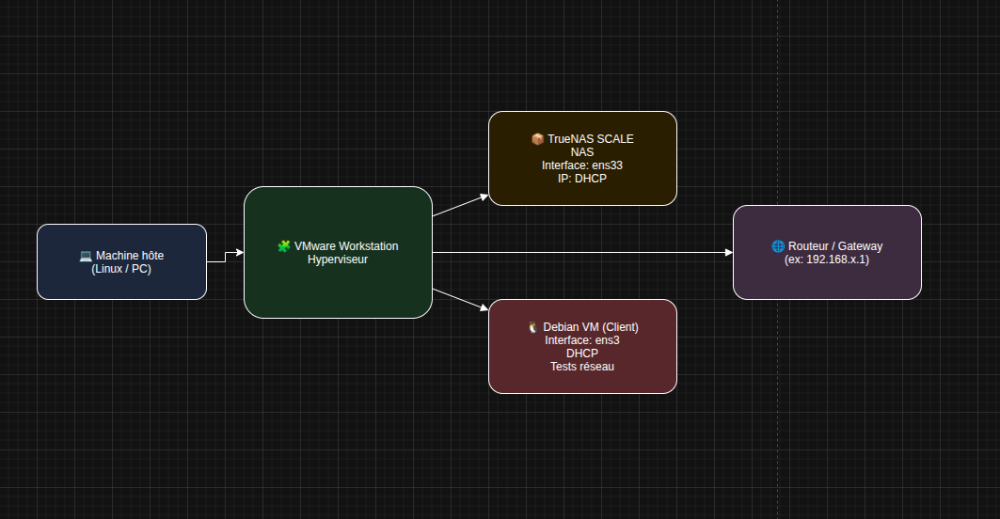
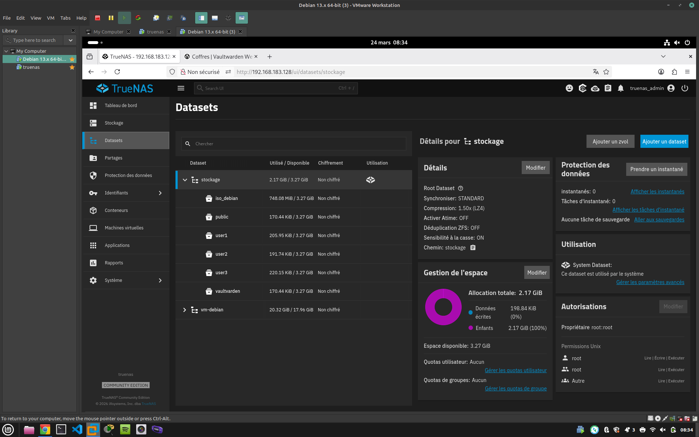
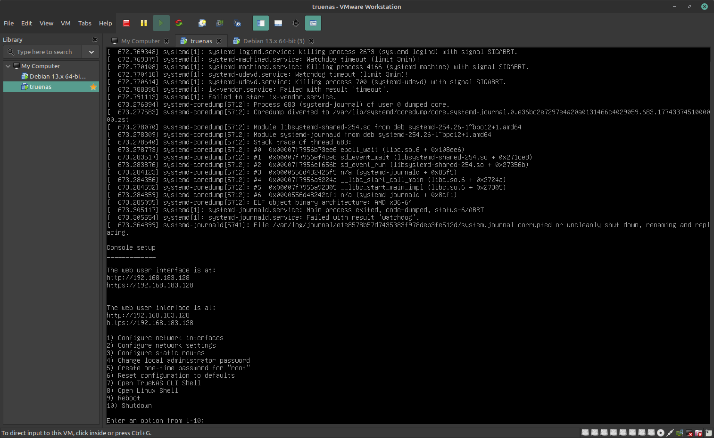

# 🖥️ Lab TrueNAS + Debian

> Mise en place d'un environnement virtualisé sous VMware : un NAS TrueNAS et une VM Debian cliente.

---

## 📋 Présentation

Mise en place d'un environnement virtualisé avec :

- TrueNAS (NAS)
- VM Debian
- Configuration réseau sous VMware



---

## 🎯 Objectifs

- Comprendre la virtualisation réseau
- Configurer un NAS
- Déployer une VM Linux
- Gérer les problèmes réseau (gateway, DHCP, bridge)

---

## 🛠️ Technologies utilisées

- VMware Workstation
- TrueNAS
- Debian 13
- Linux networking (`ip`, `route`, DHCP)

---

## ⚠️ Problèmes rencontrés

- Pas d'accès internet (NAT vs Bridged)
- Mauvaise gateway
- Interface DOWN
- Clavier QWERTY

Le détail du diagnostic et des correctifs est dans [doc/# Debug réseau.md](<doc/# Debug réseau.md>).

---

## 📸 Aperçu





---

## ✅ Résultat

- VM fonctionnelle
- Accès réseau OK
- Infrastructure stable

---

## 🧠 Compétences démontrées

- **Virtualisation** : environnement VMware Workstation avec TrueNAS et une VM Debian 13.
- **Stockage** : installation et configuration d'un NAS TrueNAS.
- **Réseau Linux** : adressage IP, gateway, DHCP, modes NAT et Bridged, lecture de `ip a` et `ip route`.
- **Diagnostic** : méthode de dépannage réseau (symptômes, vérifications, causes, correctifs) documentée.
- **Documentation** : schéma d'architecture, captures d'écran et fiche de debug.

---

## 📁 Structure du dépôt

```
truenas/
├── README.md
├── truenas.md               # Fiche du lab
├── architecture/            # Schéma d'architecture (draw.io)
├── doc/                     # Fiche de debug réseau
└── screenshots/             # Captures d'écran
```

---

## 👤 Auteur

**Alexis Noiret** — Bachelor IT Cybersécurité, La Plateforme

- Portfolio : [alexis-noiret.students-laplateforme.io](https://alexis-noiret.students-laplateforme.io)
- GitHub : [github.com/alexis-noiret](https://github.com/alexis-noiret)
